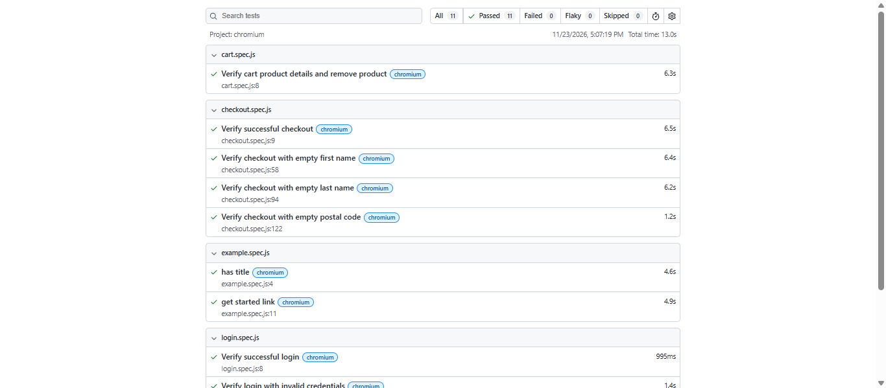

//


# SauceDemo Playwright Automation

## Project Overview

This project is a UI automation testing framework developed using Playwright with JavaScript. It automates important end-to-end scenarios on the SauceDemo e-commerce application.

The framework follows the Page Object Model (POM) design pattern to improve code reusability, maintainability, and readability.

## Technologies Used

- JavaScript
- Playwright Test
- Node.js
- Page Object Model (POM)
- JSON Test Data
- Git and GitHub
- GitHub Actions (CI)

## Project Structure

```text
SauceDemo-Playwright-Automation/
│
├── .github/
│   └── workflows/
│       └── playwright.yml
│
├── pages/
│   ├── LoginPage.js
│   ├── ProductsPage.js
│   ├── CartPage.js
│   └── CheckoutPage.js
│
├── test-data/
│   └── users.json
│
├── tests/
│   ├── login.spec.js
│   ├── products.spec.js
│   ├── cart.spec.js
│   ├── checkout.spec.js
│   └── example.spec.js
│
├── .gitignore
├── package.json
├── package-lock.json
└── playwright.config.js
```

## Automated Test Scenarios

### Login
- Verify successful login with valid credentials.
- Verify login failure with invalid credentials.
- Verify locked-out user login.

### Products
- Verify products page after login.
- Verify product count.
- Add a product to the shopping cart.
- Verify cart badge count.

### Shopping Cart
- Verify cart contents.
- Verify product name and price.
- Remove a product from the cart.

### Checkout
- Complete a successful checkout.
- Verify validation for missing first name.
- Verify validation for missing last name.
- Verify validation for missing postal code.

## Installation and Setup

Clone the repository:

```bash
git clone https://github.com/VinayKumarP09/SauceDemo-Playwright-Automation.git
```

Navigate to the project:

```bash
cd SauceDemo-Playwright-Automation
```

Install dependencies:

```bash
npm install
```

Install Playwright browsers:

```bash
npx playwright install
```

## Execute Tests

Run all tests:

```bash
npx playwright test
```

Run tests on Chromium:

```bash
npx playwright test --project=chromium
```

Run tests in headed mode:

```bash
npx playwright test --project=chromium --headed
```

Run a specific test file:

```bash
npx playwright test tests/login.spec.js --project=chromium
```

View the HTML report:

```bash
npx playwright show-report
```

## Test Execution

The current Chromium test suite has successfully executed **11 tests with 0 failures**.

## Application Under Test

https://www.saucedemo.com/

## Author

Vinay Kumar Pedda

GitHub: https://github.com/VinayKumarP09


## Test Execution Report

The Playwright HTML report confirms that all 11 automated tests passed successfully with 0 failures.




## API Testing – Postman

API testing is performed using Postman with JSONPlaceholder REST APIs.

### API Test Coverage

- GET – Retrieve a single post
- GET – Retrieve all posts
- POST – Create a new post
- PUT – Update an existing post
- PATCH – Partially update a post
- DELETE – Delete an existing post
- Request header validation
- Query parameter validation
- Status code and response body validation
- JSON schema validation
- Dynamic test data validation
- Response time validation

### Collection

The Postman collection is available in:

`postman/SauceDemo-Portfolio-API-Testing.json`